# 🏠 HomeHunt — Real Estate Marketplace

<p align="center">
  <b>A Full-Stack Real Estate Marketplace Built with MERN Stack</b>
</p>

<p align="center">
  
  
  
  
  
  
  
</p>

<p align="center">
  <a href="https://home-hunt-iota.vercel.app">Live Demo</a> •
  <a href="https://homehunt-xiwm.onrender.com">Backend API</a>
</p>

---

## 📖 About the Project

**HomeHunt** is a full-stack real-estate marketplace designed to connect property buyers with real-estate agents.

The platform provides property discovery, advanced filtering, property management, appointment scheduling, real-time messaging, reviews, analytics dashboards and administrative management.

HomeHunt features three different roles — **Buyer, Agent and Admin** — each with dedicated functionality and access permissions.

The application is built using the MERN stack, Redux Toolkit, Socket.io and Cloudinary, with the frontend deployed on Vercel and the backend deployed on Render.

---

## 🌐 Live Application

| Component | URL |
|---|---|
| Frontend | [HomeHunt](https://home-hunt-iota.vercel.app) |
| Backend API | [HomeHunt API](https://homehunt-xiwm.onrender.com) |
| Health Check | [API Health](https://homehunt-xiwm.onrender.com/api/health) |

---

## ✨ Features

### 👤 Authentication & Authorization
- User registration and login.
- JWT-based authentication.
- Secure password hashing using bcryptjs.
- Role-based access control.
- Protected frontend routes.
- Protected backend APIs.
- Session restoration.
- Profile management.

### 🏘️ Property Management
- Create, update and delete property listings.
- Upload property images using Cloudinary.
- Property types and listing types.
- Property details including price, bedrooms, bathrooms, area and furnishing.
- Amenities and location information.
- Property verification.
- Featured properties.
- Property approval workflow.

### 🔍 Property Discovery
- Search properties.
- Filter by property type.
- Filter by listing type.
- Filter by price.
- Filter by bedrooms and bathrooms.
- Location-based filtering.
- Sorting.
- Pagination.

### ❤️ Bookmarks
- Save favorite properties.
- View saved properties.
- Remove bookmarked properties.
- Prevent duplicate bookmarks.

### 📅 Property Visit Scheduling
- Request property visits.
- Select date and time.
- Add visit messages.
- Manage visit requests.
- Confirm or reject appointments.
- Cancel eligible visits.
- Mark confirmed visits as completed.

### 💬 Real-Time Messaging
- Buyer-agent messaging.
- Create or retrieve conversations.
- Property-linked conversations.
- Real-time message delivery using Socket.io.
- Conversation history.
- Message timestamps.
- Read status.
- Automatic message notifications.

### 🔔 Notifications
- Real-time notifications.
- Notification unread count.
- Mark notifications as read.
- Mark all notifications as read.
- Delete notifications.
- Socket.io notification delivery.

### ⭐ Reviews & Ratings
- Submit property reviews.
- Ratings from 1 to 5.
- Review comments.
- Edit reviews.
- Delete reviews.
- Property rating statistics.

### 📊 Agent Dashboard
- Total properties.
- Total property views.
- Scheduled visits.
- New inquiries.
- Average rating.
- Total reviews.
- Available, sold and rented property statistics.
- Property views chart.
- Property status chart.
- Top viewed properties.
- Upcoming visits.
- Recent inquiries.
- Recent reviews.

### 🛡️ Admin Dashboard
- Platform statistics.
- User role analytics.
- Property approval analytics.
- Property status analytics.
- Property type analytics.

### 👥 Admin User Management
- View users.
- Search users.
- Filter users.
- Pagination.
- Activate and deactivate users.
- Soft-delete users.
- Restore deleted users.

### 🏢 Admin Property Management
- View property listings.
- Approve properties.
- Reject properties.
- Verify and unverify listings.
- Feature and unfeature properties.
- Update property statuses.

### 📋 Admin Activity Log
- Track administrative actions.
- Property approval and rejection tracking.
- Property verification tracking.
- User management activity tracking.
- Filter activity records.

### 📥 Admin Reports
- Export user reports.
- Export property reports.
- Export visit reports.
- Export review reports.
- Date-based filtering.
- Excel file generation using ExcelJS.

### 🧮 EMI Calculator
- Calculate estimated monthly home loan payments.
- Loan amount.
- Interest rate.
- Loan duration.
- Monthly EMI estimation.

---

## 👥 User Roles

| Role | Capabilities |
|---|---|
| Buyer | Browse properties, search, bookmark, schedule visits, message agents and review properties |
| Agent | Manage listings, handle visits, communicate with buyers and monitor analytics |
| Admin | Manage users, approve properties, verify listings, track activities and generate reports |

---

## 🛠️ Tech Stack

### Frontend
- React
- Vite
- JavaScript
- Redux Toolkit
- React Router
- Tailwind CSS
- Axios
- Socket.io Client
- Recharts
- Lucide React

### Backend
- Node.js
- Express.js
- MongoDB
- Mongoose
- JWT
- bcryptjs
- Socket.io
- Multer
- Cloudinary
- ExcelJS
- Helmet
- Express Rate Limit

### Deployment & Services
- Vercel – Frontend Hosting
- Render – Backend Hosting
- MongoDB Atlas – Cloud Database
- Cloudinary – Image Storage

---

## 🏗️ Architecture

```mermaid
flowchart TD
    A[Buyer / Agent / Admin] --> B[React Frontend]
    B --> C[Redux Toolkit]
    B --> D[Axios API Requests]
    B --> E[Socket.io Client]

    D --> F[Express REST API]
    E --> G[Socket.io Server]

    F --> H[Authentication Middleware]
    H --> I[Controllers]
    I --> J[Mongoose Models]
    J --> K[(MongoDB Atlas)]

    I --> L[Cloudinary]
    I --> M[ExcelJS Reports]

    G --> N[Real-Time Messages]
    G --> O[Real-Time Notifications]
```



---

## 📂 Project Structure

```text
HomeHunt/
│
├── frontend/
│   ├── public/
│   └── src/
│       ├── app/
│       │   └── slices/
│       ├── components/
│       ├── layouts/
│       ├── pages/
│       │   ├── admin/
│       │   └── agent/
│       ├── services/
│       │   ├── api/
│       │   └── socket.js
│       ├── hooks/
│       ├── stores/
│       ├── App.jsx
│       └── main.jsx
│
├── backend/
│   ├── src/
│   │   ├── config/
│   │   ├── controllers/
│   │   ├── middleware/
│   │   ├── models/
│   │   ├── routes/
│   │   ├── sockets/
│   │   ├── utils/
│   │   ├── app.js
│   │   └── server.js
│   ├── package.json
│   └── .env
│
└── README.md
```

---

## 🚀 Getting Started

Follow these steps to run HomeHunt locally.

### 1. Clone the Repository

```bash
git clone https://github.com/Ekthasurya/HomeHunt.git
```

```bash
cd HomeHunt
```

### 2. Setup Backend

```bash
cd backend
npm install
```

Create a `.env` file inside the backend folder.

```env
PORT=5000

MONGODB_URI=your_mongodb_connection_string

JWT_SECRET=your_jwt_secret

CLIENT_URL=http://localhost:5173

CLOUDINARY_CLOUD_NAME=your_cloudinary_cloud_name
CLOUDINARY_API_KEY=your_cloudinary_api_key
CLOUDINARY_API_SECRET=your_cloudinary_api_secret

NODE_ENV=development
```

> Use the exact environment variable names expected by your backend configuration.

Start the backend server:

```bash
npm run dev
```

Backend runs at:

```text
http://localhost:5000
```

### 3. Setup Frontend

Open another terminal.

```bash
cd frontend
npm install
```

Create a `.env` file inside the frontend folder.

```env
VITE_API_URL=http://localhost:5000/api
VITE_SOCKET_URL=http://localhost:5000
```

Start the frontend:

```bash
npm run dev
```

Frontend runs at:

```text
http://localhost:5173
```

---

## 🔐 Authentication Flow

1. User registers or logs in.
2. Backend validates credentials.
3. Password is verified using bcryptjs.
4. JWT is generated.
5. Authentication cookie is issued.
6. Protected requests are validated using middleware.
7. Role-based authorization controls access.

---

## 💬 Real-Time Messaging Flow

1. Buyer initiates a conversation with an agent.
2. Backend creates or retrieves an existing conversation.
3. Participants join a Socket.io conversation room.
4. Messages are stored in MongoDB.
5. Socket.io broadcasts messages to the conversation room.
6. Recipient receives messages in real time.
7. Notifications are generated for recipients.

---


## 🔒 Security

- Password hashing with bcryptjs.
- JWT-based authentication.
- Role-based authorization.
- Protected API routes.
- Protected frontend routes.
- HTTP-only authentication cookies.
- CORS configuration.
- Helmet security headers.
- API rate limiting.
- MongoDB validation.
- Soft-delete support for users.

---

## 📈 Future Improvements

- Typing indicators.
- Online and offline user status.
- Advanced message read receipts.
- Map-based property search.
- Advanced property recommendations.
- Email notifications.
- Property comparison.
- More advanced responsive chat experience.
- Automated testing.
- Improved production monitoring.

---

## 👨‍💻 Developer

**Surya Kiran Majhi**

MERN Stack Developer

- GitHub: [Ekthasurya](https://github.com/Ekthasurya)

---

## ⭐ Support

If you like this project, consider giving it a ⭐ on GitHub.

<p align="center">
  <b>HomeHunt — Find Your Dream Home.</b>
</p>
